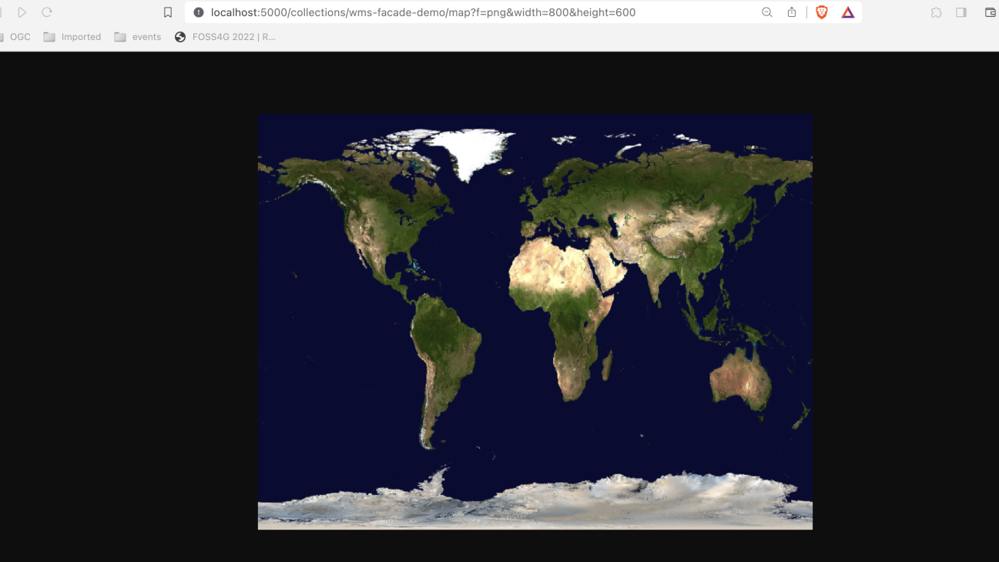

# Exercise 9 - pygeoapi as a bridge to other services

In this section we explore how pygeoapi can be used as a facade, or a bridge, to re-publish web services with different interfaces. These bridges can help [organisations migrating from OWS to OGC API](https://ogcapi-workshop.ogc.org/transition-and-migration).

## Publishing WFS as OGC API - Features

A powerful use case for pygeoapi is to provide an OGC API - Features interface over existing Web Feature Service (WFS) 
or ESRI FeatureServer endpoints. In this scenario, you lower the barrier and increase the usability of existing services to 
a wider audience. Let's set up an API on top of an existing WFS hosted by the Nordeste Municipality of Azores.

!!! question "Update the pygeoapi configuration"

    Open the pygeoapi configuration in a text editor. 
    Find the line `# START - EXERCISE 9 - WFS Proxy`.

    Add a new dataset section by uncommenting the lines up to `# END - EXERCISE 9 - WFS Proxy`:


    ``` {.yaml linenums="1"}
     toponimia:
        type: collection
        title: 'Cartografia 5000 Amraa: Toponimia'
        description: Toponomy of São Miguel Island - Azores
        keywords:
            - cartografia
            - toponimia
        links:
            - type: text/xml
              rel: canonical
              title: Nordeste Municipality Geoportal
              href: https://sigweb.cmnordeste.pt/
              hreflang: en
        extents:
            spatial:
                bbox: [-25.304390705495628, 37.80673648981517, -25.13806870205929, 37.85526963071003]
                crs: http://www.opengis.net/def/crs/OGC/1.3/CRS84
        providers:
            - type: feature
              name: OGR
              data:
                    source_type: WFS
                    source: WFS:https://sigweb.cmnordeste.pt/geoserver/ows?service=WFS
                    source_capabilities:
                        paging: True
                    source_options:
                        OGR_WFS_LOAD_MULTIPLE_LAYER_DEFN: NO
                    gdal_ogr_options:
                        EMPTY_AS_NULL: NO
                        GDAL_CACHEMAX: 64
                        CPL_DEBUG: NO
              id_field: gml_id
              crs:
                - http://www.opengis.net/def/crs/OGC/1.3/CRS84
                - http://www.opengis.net/def/crs/EPSG/0/4326
                - http://www.opengis.net/def/crs/EPSG/0/3857
              storage_crs: http://www.opengis.net/def/crs/EPSG/0/5015
              title_field: nome
              layer: igv.cartografia_5000_amraa:toponimia
    ```

Save the file and restart Docker Compose. Navigate to <http://localhost:5000/collections>
to evaluate whether the new dataset has been published.
 
Note these important configuration slices under `providers`:

* We use the pygeoapi [OGR Provider](https://docs.pygeoapi.io/en/latest/publishing/ogcapi-features.html#ogr). 
This is the most versatile backend of pygeoapi for supporting numerous formats. Using the GDAL/OGR library (Python bindings) allows pygeoapi to connect to [around 80+ Vector Formats](https://gdal.org/drivers/vector).

* `storage_crs` denotes the CRS (Coordinate Reference System) in which the dataset is stored (default is CRS84, i.e. 'longitude, latitude') 
* `crs` is an array of CRSs that can be specified for the Features to be returned (`crs=` parameter), or for their bounding box (`bbox-crs=` parameter). Default is also CRS84.
 
CRS support effectively allows pygeoapi to *reproject* the data from its storage CRS (here EPSG:5015)
according to [OGC API - Features - Part 2: Coordinate Reference Systems by Reference](https://docs.opengeospatial.org/is/18-058r1/18-058r1.html).
The Advanced section of this workshop will further [elaborate pygeoapi CRS support](../advanced/crs.md).

!!! tip

    Remember that you can use the clients suggested [here](https://dive.pygeoapi.io/publishing/ogcapi-features/#client-access) to explore this API.

## Publishing WMS as OGC API - Maps

We can use the pygeoapi's WMSFacade provider to publish OGC Web Map Service (WMS) interfaces as OGC API - Maps.

 Let's set up an API on top of an existing WMS on the MapServer Demonstration Server:
 
 <https://demo.mapserver.org/cgi-bin/msautotest>


!!! note

    Feel free to use an WMS of your choice, as you wish!

!!! question "Update the pygeoapi configuration"

    Open the pygeoapi configuration in a text editor. 
    Find the line `## START - EXERCISE 9 - WMS Proxy`.

    Add a new dataset section by uncommenting the lines up to `## END - EXERCISE 9 - WMS Proxy`:

     Be sure to keep the proper YAML indentation.

    ``` {.yaml linenums="1"}
    wms-facade-demo:
        type: collection
        title: WMS Facade demo
        description: WMS Facade demo
        keywords:
            - WMS facade
        links:
            - type: text/html
              rel: canonical
              title: MapServer
              href: https://mapserver.org
              hreflang: en
        extents:
            spatial:
                bbox: [-180,-90,180,90]
                crs: http://www.opengis.net/def/crs/OGC/1.3/CRS84
        providers:
            - type: map
              name: WMSFacade
              data: https://demo.mapserver.org/cgi-bin/msautotest
              options:
                  layer: world_latlong
                  style: default
              format:
                  name: png
                  mimetype: image/png
    ```

Run the following requests in your web browser:

- default map: <http://localhost:5000/collections/wms-facade-demo/map?f=png>
- specific width/height: <http://localhost:5000/collections/wms-facade-demo/map?f=png&width=800&height=600>
- specific area of interest (bbox of Canada): <http://localhost:5000/collections/wms-facade-demo/map?f=png&width=800&height=600&bbox=-142,42,-52,84>

{ width=80% }

!!! tip

    Try with your own bbox and width/height values!

!!! tip

    Remember that you can use the clients suggested [here](https://dive.pygeoapi.io/publishing/ogcapi-maps/#client-access) to explore this API.

## Publishing CSW as OGC API - Records

In this section we'll have a look at how to publish Catalogue Service for the Web (CSW) as OGC API - Records. For that, we will use the [pycsw OGC CITE demo](https://demo.pycsw.org/cite/) CSW service.

!!! question "Update the pygeoapi configuration"

    Open the pygeoapi configuration in a text editor. 
    Find the line `# START - EXERCISE 9 - CSW Proxy`.

    Add a new dataset section by uncommenting the lines up to `# END - EXERCISE 9 - CSW Proxy`:

    ``` {.yaml linenums="1"}
    cite_demo:
        type: collection
        title: pycsw OGC CITE demo and Reference Implementation
        description: pycsw is an OARec and OGC CSW server implementation written in Python. pycsw fully implements the OGC API - Records and OpenGIS Catalogue Service Implementation Specification (Catalogue Service for the Web). Initial development started in 2010 (more formally announced in 2011). The project is certified OGC Compliant, and is an OGC Reference Implementation. Since 2015, pycsw is an official OSGeo Project. pycsw allows for the publishing and discovery of geospatial metadata via numerous APIs (CSW 2/CSW 3, OpenSearch, OAI-PMH, SRU). Existing repositories of geospatial metadata can also be exposed, providing a standards-based metadata and catalogue component of spatial data infrastructures. pycsw is Open Source, released under an MIT license, and runs on all major platforms (Windows, Linux, Mac OS X)
        keywords:
            - ogc
            - cite
            - compliance
            - interoperability
        extents:
            spatial:
                bbox: [-180,-90,180,90]
                crs: http://www.opengis.net/def/crs/OGC/1.3/CRS84
        providers:
            - type: record
              name: CSWFacade
              data: https://demo.pycsw.org/cite/csw
              id_field: identifier
              time_field: datetime
              title_field: title
    ```

You can explore the proxied catalogue collection using this endpoints:

* collection metadata page: <http://localhost:5000/collections/cite_demo>
* list of records: <http://localhost:5000/collections/cite_demo/items>
* record: <http://localhost:5000/collections/cite_demo/items/urn:uuid:19887a8a-f6b0-4a63-ae56-7fba0e17801f>

!!! tip

    Remember that you can use the clients suggested [here](https://dive.pygeoapi.io/publishing/ogcapi-records/#client-access) to explore this API.

## Publishing SensorThings API as OGC API - Features

The [OGC SensorThings API standard](https://ogcapi-workshop.ogc.org/api-deep-dive/sensorthings/) offers RESTfull interfaces to interconnect IoT devices, data, in an open and unified way. Although there are some clients that support this standard, there are many more that support OGC API - Features.

The pygeoapi SensorThings bridge enables to proxy the SensorThings entities (e.g.:  `Thing` , `Sensor`, `DataStream`, `ObservedProperty` ) into feature collections.

In this section we'll have a look at how to Publish a SensorThings API `Thing` as an OGC API - Features collection, which can then be consumed by various clients, like [the ones listed here](../publishing/ogcapi-features.md#client-access)

!!! question "Update the pygeoapi configuration"

    Open the pygeoapi configuration in a text editor. 
    Find the line `# START - EXERCISE 9 - SensorThings Proxy`.

    Add a new dataset section by uncommenting the lines up to `# END - EXERCISE 9 - SensorThings Proxy`:

    ``` {.yaml linenums="1"}
    toronto_bikes:
        type: collection
        title: Toronto Bikes SensorThings
        description: The geographic location with coordinates for the Toronto bike share station
        keywords:
            - sensors
            - bikes
        extents:
            spatial:
                bbox: [-180,-90,180,90]
                crs: http://www.opengis.net/def/crs/OGC/1.3/CRS84
        providers:
            - type: feature
              name: SensorThings
              data: https://toronto-bike-snapshot.sensorup.com/v1.0/
              entity: Things
    ```
