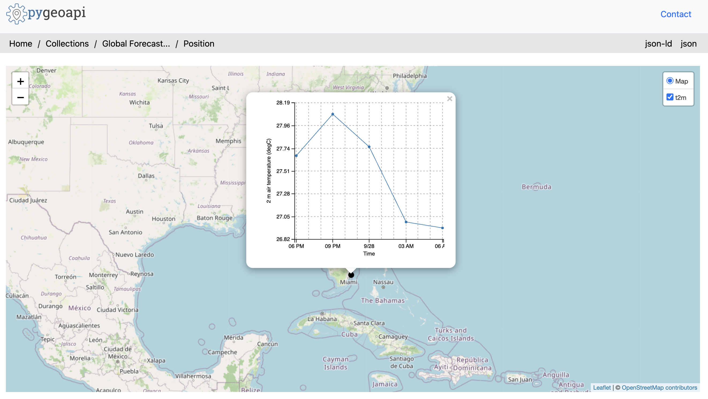
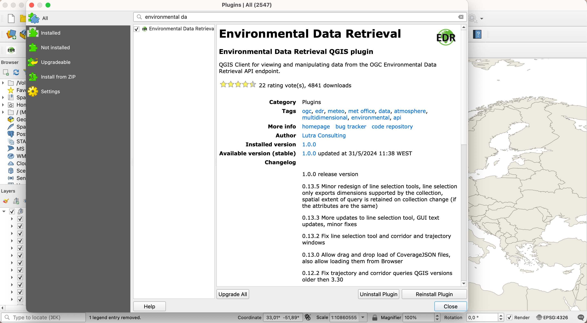
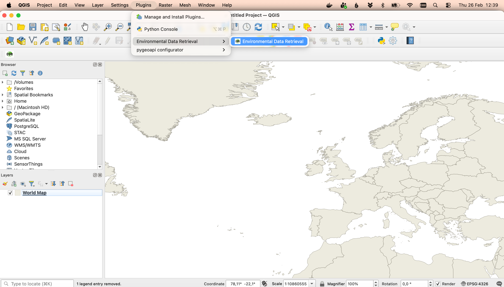

# Exercício 7 - Dados ambientais via OGC API - Environmental Data Retrieval

[OGC API - Environmental Data Retrieval](https://ogcapi.ogc.org/edr) fornece uma Web API para aceder
a dados ambientais usando padrões de consulta bem definidos:

* [Norma OGC API - Environmental Data Retrieval](https://docs.ogc.org/is/19-086r4/19-086r4.html)

A OGC API - Environmental Data Retrieval utiliza a OGC API - Features como bloco de construção, permitindo assim
integração simplificada para clientes e utilizadores. A EDR pode ser considerada uma API de conveniência que não
requer conhecimento aprofundado sobre o armazenamento/modelo de dados subjacente.

## Suporte na pygeoapi

A pygeoapi suporta a especificação OGC API - Environmental Data Retrieval aproveitando tanto plugins de fornecedor
de funcionalidades como de cobertura.

!!! note

    Consulte [a documentação oficial](https://docs.pygeoapi.io/en/latest/publishing/ogcapi-edr.html) para mais informações sobre backends EDR suportados


## Publicar dados ambientais na pygeoapi

Vamos tentar publicar dados de exemplo de um [modelo de previsão meteorológica](https://www.ncei.noaa.gov/products/weather-climate-models/global-forecast) do NOAA através do plugin EDR xarray. Os dados de exemplo podem ser encontrados em `workshop/exercises/data/gfs_tmp2m.zarr`:


!!! question "Atualizar a configuração da pygeoapi"

    Abra o ficheiro de configuração da pygeoapi num editor de texto. Adicione uma nova secção de conjunto de dados da seguinte forma:

``` {.yaml linenums="1"}
    noaa-gfs:
        type: collection
        title: Global Forecast System (GFS), 2 metre air temperature
        description: Global Forecast System (GFS), 2 metre air temperature
        keywords:
            - gfs
            - forecast
            - air temperature
        extents:
            spatial:
                bbox: [-128,23,-65,50]
                crs: http://www.opengis.net/def/crs/OGC/1.3/CRS84
            temporal:
                begin: 2023-09-27T18:00:00Z
                end: 2023-09-28T06:00:00Z
        links:
            - type: text/html
              rel: canonical
              title: information
              href: https://www.ncei.noaa.gov/products/weather-climate-models/global-forecast
              hreflang: en-US
        providers:
            - type: edr
              name: xarray-edr
              data: /data/gfs_tmp2m.zarr
              x_field: lon
              y_field: lat
              time_field: time
              format:
                  name: zarr
                  mimetype: application/zip
```

Guarde a configuração e reinicie o Docker Compose. Navegue para <http://localhost:5000/collections> para avaliar se o novo conjunto de dados foi publicado.

À primeira vista, a coleção Global Forecast System (GFS), 2 metre air temperature (`noaa-gfs`) parece uma coleção OGC API normal. Olhe um pouco mais de perto para a descrição da coleção (<http://localhost:5000/collection/noaa-gfs>), e note as secções "Data Queries" e "Parameters" (adicione `f=json` ao URL da descrição da coleção para inspecionar os elementos específicos da EDR, tais como `data_queries` e `parameter_names`, entre outros elementos JSON). A secção "Parameters" descreve os parâmetros ambientais associados à coleção, que podem ser usados como parte de uma consulta da coleção.

Tente visualizar a seguinte consulta de posição da EDR (centrada em Fort Lauderdale, EUA) num navegador web: <http://localhost:5000/collections/noaa-gfs/position?coords=POINT(-80.1373%2026.1224)>. Note o gráfico interativo que exibe a série temporal de dados de temperatura a 2 metros.

{ width=100% }

## Acesso do lado do cliente

### QGIS

O [QGIS](https://qgis.org/) dá suporte à OGC API - EDR através do [plugin EDR](https://plugins.qgis.org/plugins/edr_plugin/). Pode instalá-lo diretamente através do QGIS Plugin Hub, indo a `Plugins->Manage and Install Plugins` no menu de topo.

{ width=100% }

Pode aceder ao plugin através de uma entrada no menu de plugins.

{ width=100% }

### OWSLib - Avançado

[OWSLib](https://owslib.readthedocs.io) é uma biblioteca Python para interagir com Serviços Web OGC e suporta várias OGC APIs, incluindo a OGC API - Environmental Data Retrieval.

!!! question "Interagir com OGC API - Environmental Data Retrieval via OWSLib"

    Se não tem Python instalado, considere executar este exercício num contentor Docker. Consulte o [Capítulo de Configuração](../setup.pt.md#usar-o-docker-para-clientes-python).

    === "Linux/Mac"

        ```bash
        pip3 install owslib
        ```

    === "Windows (PowerShell)"

        ```bash
        pip3 install owslib
        ```

    Depois, inicie uma sessão de consola Python com `python3` (pare a sessão escrevendo `exit()`).

    === "Linux/Mac"

        ```python
        >>> from owslib.ogcapi.edr import  EnvironmentalDataRetrieval
        >>> w = EnvironmentalDataRetrieval('https://demo.pygeoapi.io/master')
        >>> w.url
        'https://demo.pygeoapi.io/master'
        >>> api = w.api()  # documento OpenAPI
        >>> collections = w.collections()
        >>> len(collections['collections'])
        13
        >>> noaa_gfs = w.collection('noaa-gfs')
        >>> noaa_gfs['parameter_names'].keys()
        dict_keys(['t2m'])
        >>> data = w.query_data('noaa-gfs', 'position', coords='POINT(-80.1373 26.1224)', parameter_names=['t2m'])
        >>> data  # dados CoverageJSON
        ```

    === "Windows (PowerShell)"

        ```python
        >>> from owslib.ogcapi.edr import  EnvironmentalDataRetrieval
        >>> w = EnvironmentalDataRetrieval('https://demo.pygeoapi.io/master')
        >>> w.url
        'https://demo.pygeoapi.io/master'
        >>> api = w.api()  # documento OpenAPI
        >>> collections = w.collections()
        >>> len(collections['collections'])
        13
        >>> noaa_gfs= w.collection('noaa-gfs')
        >>> noaa_gfs['parameter_names'].keys()
        dict_keys(['t2m'])
        >>> data = w.query_data('noaa-gfs', 'position', coords='POINT(-80.1373 26.1224)', parameter_names=['t2m'])
        >>> data  # dados CoverageJSON
        ```

!!! note

    Consulte a [documentação oficial da OWSLib](https://owslib.readthedocs.io/en/latest/usage.html#ogc-api) para mais exemplos.

# Resumo

Parabéns! Agora é capaz de publicar dados ambientais na pygeoapi.
