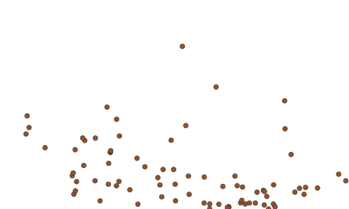
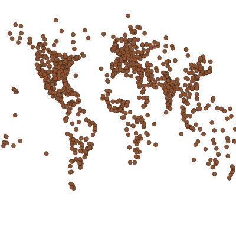
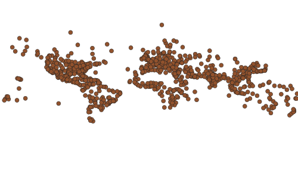
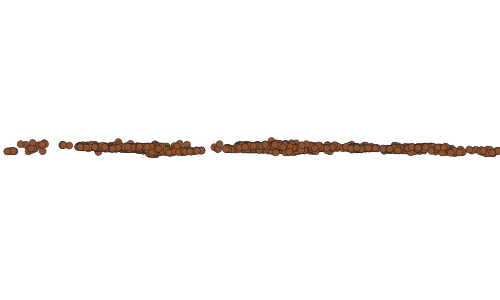
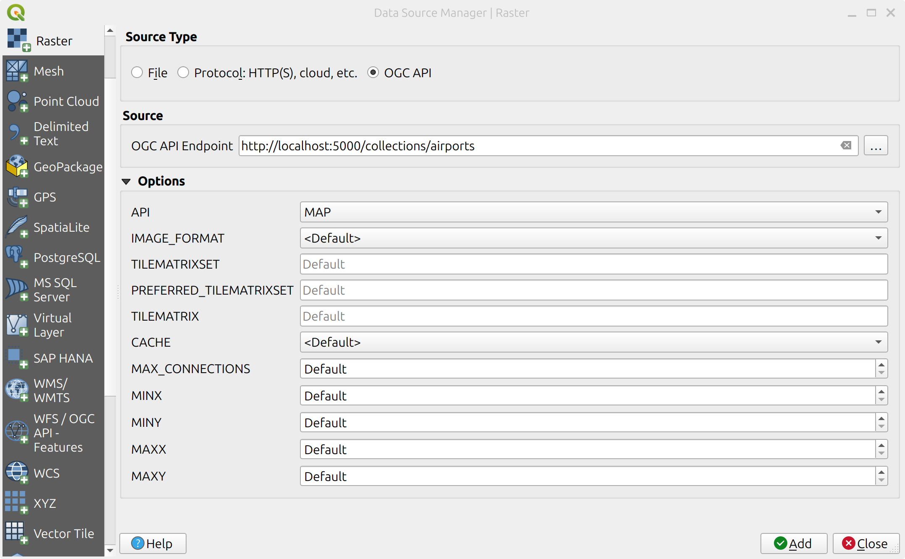
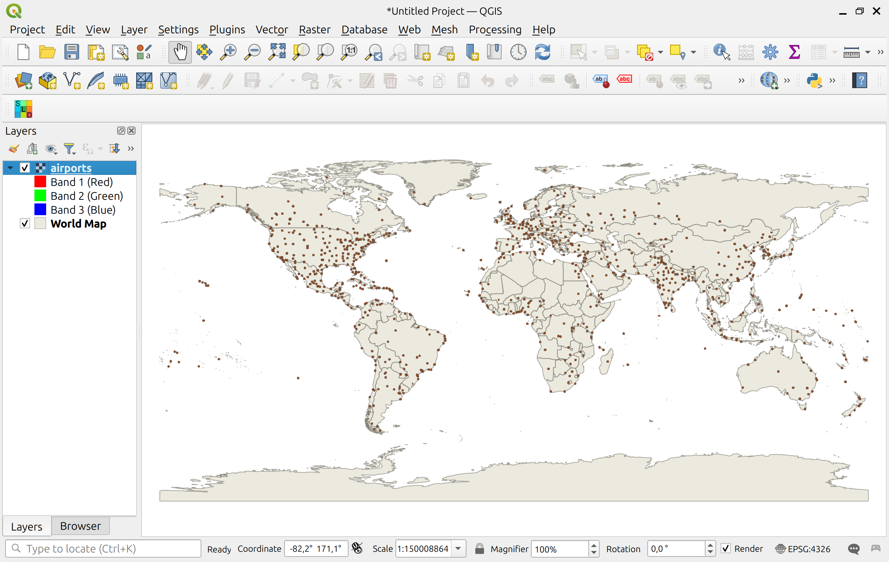

# Exercício 4 - Mapas de dados geoespaciais via OGC API - Maps

A [OGC API - Maps](https://ogcapi.ogc.org/maps) fornece uma API Web para aceder a quaisquer dados geoespaciais como uma imagem de mapa georreferenciada.

* [OGC API - Maps](https://docs.ogc.org/is/20-058/20-058.html)

Aqui estão algumas das coisas que um cliente pode pedir a um servidor da OGC API - Maps:

* Pedir uma representação visual de uma ou mais camadas de dados geoespaciais, em diferentes estilos;
* Selecionar por área, tempo e resolução de interesse;
* Alterar parâmetros, tal como largura, altura e sistemas de referência de coordenadas.

!!! note

    Embora a OGC API - Maps seja ótima para fornecer mapas dinâmicos na Web, se os seus dados se basearem num esquema de mosaicos definido e os mapas resultantes não precisarem de ser gerados dinamicamente, a [OGC API - Tiles](./ogcapi-tiles.pt.md) fornece uma abordagem adequada para servir os dados de forma eficiente, utilizando menos recursos do servidor.

## Suporte da pygeoapi

A pygeoapi suporta a especificação da OGC API - Maps, utilizando o [MapServer MapScript](https://www.mapserver.org/mapscript) e uma fachada WMS como backends principais.

!!! note

    Consulte [a documentação oficial](https://docs.pygeoapi.io/en/latest/publishing/ogcapi-maps.html) para mais informações sobre os backends de mapa suportados.

## Publicar um conjunto de dados vetoriais

Nesta secção, iremos expor um ficheiro Geopackage disponível na localização `workshop/exercises/data/airport.gpkg` utilizando o [MapServer MapScript](https://www.mapserver.org/mapscript). Estes dados podem ser consumidos por vários clientes compatíveis com a OGC API - Maps. Uma lista de alguns desses clientes pode ser encontrada [aqui](https://github.com/opengeospatial/ogcapi-maps/blob/master/implementations.adoc#clients). Aqui também podemos passar o estilo no formato *.sld*, que pode ser gerado no [Geoserver](https://docs.geoserver.org/stable/en/user/styling/index.html), [QGIS](https://www.qgistutorials.com/en/docs/3/basic_vector_styling.html), etc.

!!! question "Interagir com a OGC API - Maps via MapScript"

    Abra o ficheiro de configuração da pygeoapi num editor de texto. Encontre a linha `# START - EXERCISE 4 - Maps`.

    Descomente a secção relacionada com #airports.

    ```{.yaml linenums="1"}
    airports:
        type: collection
        title: airports of the world
        description: Point data representing airports around the world with various metadata such as name, Code, etc.
        keywords:
            - airports
            - natural earth
        links:
            - type: text/html
              rel: canonical
              title: information
              href: https://www.naturalearthdata.com/downloads/10m-cultural-vectors/airports/
              hreflang: en-US
        extents:
            spatial:
                bbox: [-180,-90,180,90]
                crs: http://www.opengis.net/def/crs/OGC/1.3/CRS84
            temporal:
                begin:
                end: null  # or empty
        providers:
            - type: map
              name: MapScript
              data: /data/airport.gpkg
              options:
                  type: MS_LAYER_POINT
                  layer: airport
                  style: /data/airport.sld
              format:
                  name: png
                  mimetype: image/png
            - type: feature
              name: SQLiteGPKG
              data: /data/airport.gpkg
              id_field: fid
              table: airport
    ```

Após o servidor iniciar, pode aceder à página da coleção aqui:

http://localhost:5000/collections/airports

E ao mapa aqui:

http://localhost:5000/collections/airports/map?f=png

{ width=50% }

!!! note

    Os dados de aeroportos são publicados **tanto** como mapa como coleção de *features* através de um único *endpoint* (`/collections/airports`). De que forma é isto possível na configuração acima?

O mapa vem com o CRS CRS84 por defeito, mas pode ser facilmente alterado com o parâmetro `crs`:

http://localhost:5000/collections/airports/map?f=png&crs=EPSG:3857

Também pode ajustar outros parâmetros (tal como a caixa delimitadora (`bbox`), o CRS da caixa delimitadora (`bbox-crs`), bem como `width` e `height`) para criar mapas personalizados:

http://localhost:5000/collections/airports/map?f=png&bbox-crs=OGC:CRS84&bbox=-142,42,-52,84

{ width=50% }

http://localhost:5000/collections/airports/map?f=png&width=400&height=400

{ width=50% }


!!! note

    Consulte a [Norma da OGC API - Maps](https://docs.ogc.org/is/20-058/20-058.html) para mais detalhes sobre os parâmetros de mapa.

!!! note

    A OGC API - Maps suporta CRS a partir de URI compactas (CURIEs, i.e. `EPSG:4326`, `CRS:84`), CURIEs seguras (ex.: `[EPSG:4326]`, `[CRS:84]`) e URI:

    <http://localhost:5000/collections/airports/map?f=png&crs=https://www.opengis.net/def/crs/EPSG/0/3857>

    <http://localhost:5000/collections/airports/map?f=png&crs=https://www.opengis.net/def/crs/EPSG/0/3395>

    |  |  |  |
    |:---:|:---:|:---:|
    | EPSG:4326 | EPSG:3857 | EPSG:3395 |

    Pode ler mais sobre as diferentes formas de exprimir CRS na secção de mapas da [documentação da pygeoapi](https://docs.pygeoapi.io/en/latest/publishing/ogcapi-maps.html).

## OPCIONAL: pygeoapi como um proxy WMS

Pode consultar a secção "A pygeoapi como uma Ponte para Outros Serviços" para aprender a [publicar WMS como OGC API - Maps](../advanced/bridges.pt.md#publicar-wms-como-ogc-api-maps).

## Acesso do lado do cliente

### QGIS

O QGIS adicionou suporte para APIs que fornecem camadas de imagem renderizadas através do seu suporte raster.

!!! question "Adicionar camada da OGC API - Maps ao QGIS"

    - Instale uma versão recente do QGIS (>3.28).
    - Abra o painel `Add raster layer`.
    - Selecione `OGCAPI` como tipo de fonte.
    - Adicione o *endpoint* local como fonte: `http://localhost:5000/collections/airports`.
    - Selecione `MAP` como API.
    - Finalmente, adicione a camada ao mapa.


    { width=50% }

    { width=50% }

### OWSLib

A [OWSLib](https://owslib.readthedocs.io) é uma biblioteca Python para interagir com os Serviços Web da OGC e suporta várias OGC APIs, incluindo a OGC API - Maps.

!!! question "Interagir com a OGC API - Maps via OWSLib"

    Se não tiver Python instalado, considere executar este exercício num contentor Docker. Consulte o [Capítulo de Configuração](../setup.pt.md#usar-o-docker-para-clientes-python).

    === "Linux/Mac"

        ```bash
        pip3 install owslib
        ```

    === "Windows (PowerShell)"

        ```bash
        pip3 install owslib
        ```

    A seguir, execute em Python:

    === "Linux/Mac"

        ```python
        >>> from owslib.ogcapi.maps import Maps
        >>> m = Maps('http://localhost:5000')
        >>> data = m.map('airports', width=1200, height=800, transparent=False)
        >>> with open("output.png", "wb") as fh:
        ...     fh.write(data.getbuffer())
        ```

    === "Windows (PowerShell)"

        ```python
        >>> from owslib.ogcapi.maps import Maps
        >>> m = Maps('http://localhost:5000')
        >>> data = m.map('airports', width=1200, height=800, transparent=False)
        >>> with open("output.png", "wb") as fh:
        ...     fh.write(data.getbuffer())
        ```

!!! note

    Consulte a [documentação oficial da OWSLib](https://owslib.readthedocs.io/en/latest/usage.html#ogc-api) para mais exemplos.

# Resumo

Parabéns! Agora é capaz de servir um OGC WMS através da pygeoapi e da OGC API - Maps.
